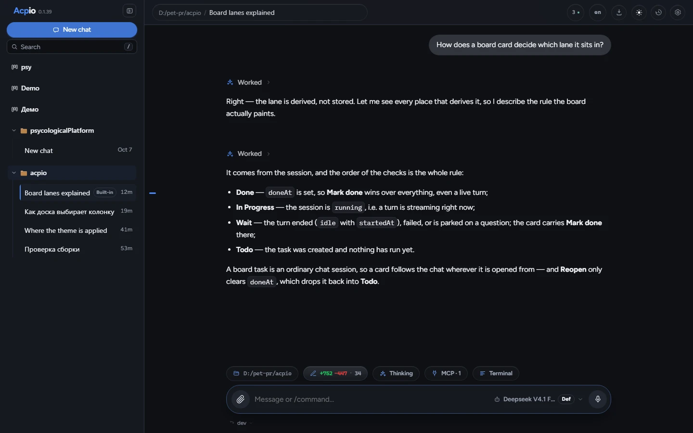
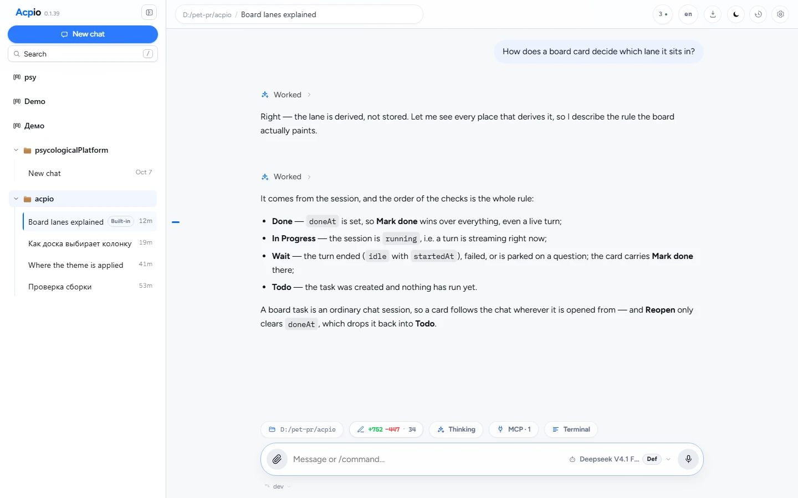
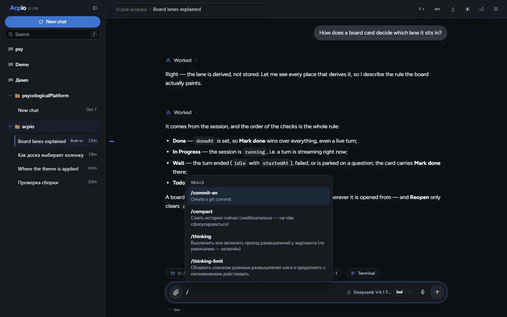
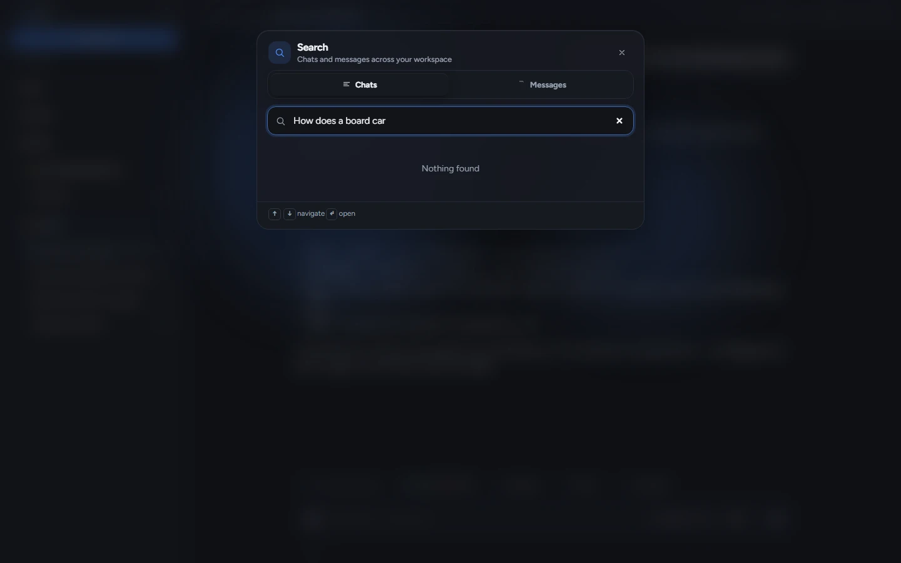
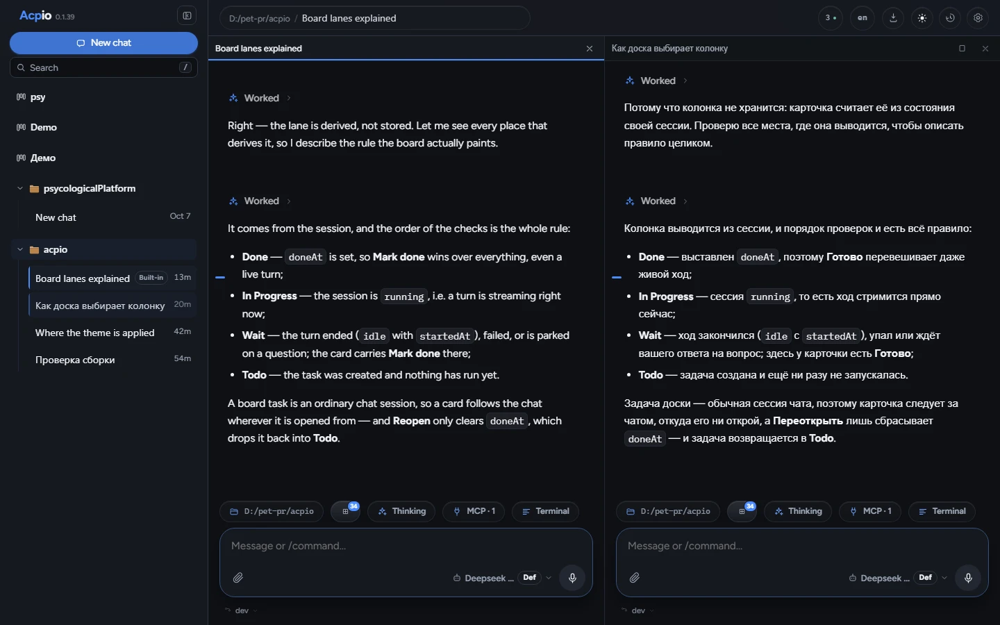
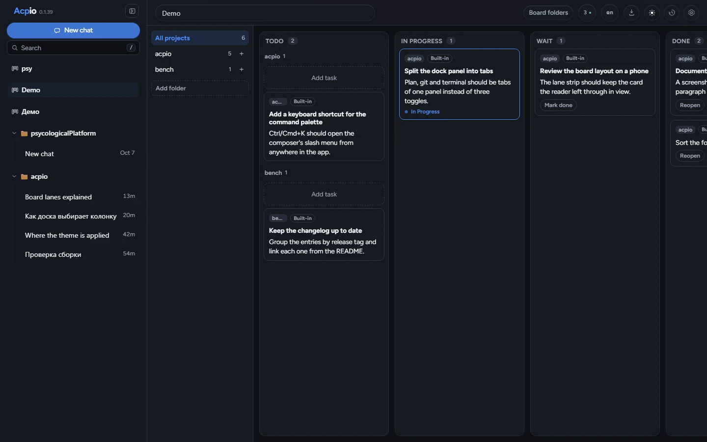
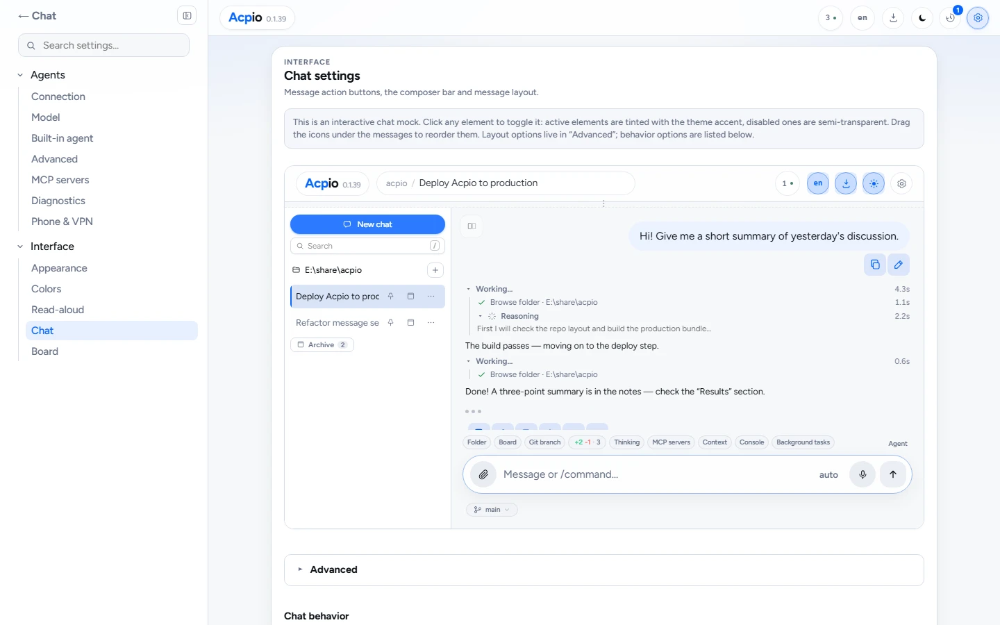
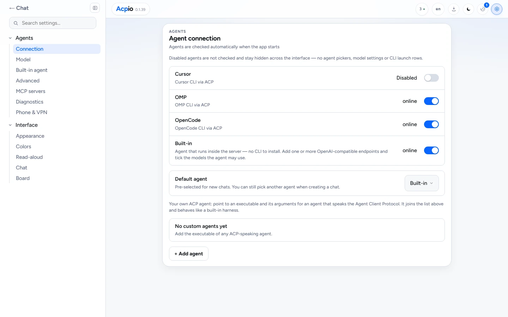
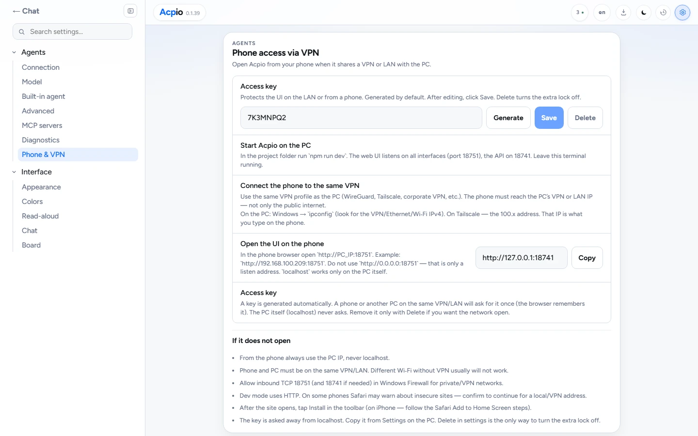
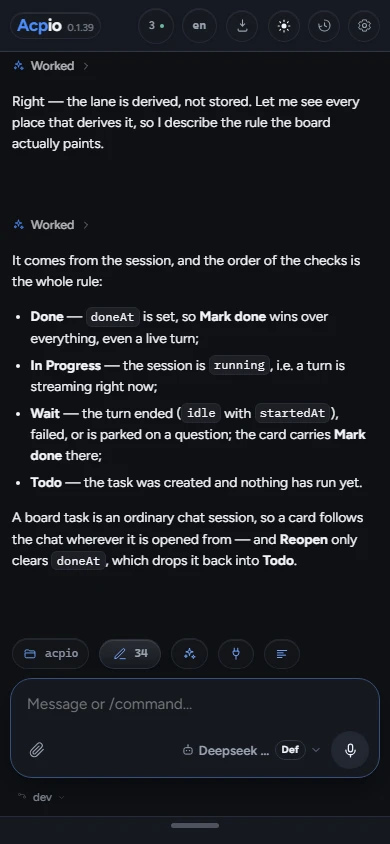

# Acpio

Self-hosted web harness for agents speaking [ACP](https://agentclientprotocol.com/):
**Cursor CLI**, **OMP**, **OpenCode** — or the **built-in agent** that runs inside the
server, so a chat works without installing a CLI at all. Kanban **boards** drive tasks
across projects, each task being a chat of its own.
Chat with streamed reasoning, tool calls and subagents, settings, META-style light/dark theme.

**Current version:** 0.1.43

> **AI disclaimer:** This project was developed in substantial part with the help of AI coding assistants. Review, test, and verify changes before relying on it in production.

## Install from npm

The shortest path — no build step, any OS:

```bash
npx acpio          # run without installing
npm i -g acpio     # global → `acpio`
```

Opens http://localhost:18741; `acpio --help` and `acpio --version` answer without
starting anything.

> **npm 11.17+** skips install-time scripts unless the package is allowed, and they
> are what builds the native modules — add
> `--allow-scripts=acpio,better-sqlite3,node-pty` to the commands above.

### Other ways to install

**One-click (Windows)** — Node 20+ is required and installed automatically on the
first run:

```powershell
irm https://raw.githubusercontent.com/Alek7eeey/acpio/dev/scripts/setup.ps1 | iex
```

**From npm through PowerShell (Windows)** — the same Node 20+ bootstrap, then a global
`npm i -g acpio@latest` with the install scripts allowed, so the native modules are built
in one go and the `acpio` command starts the app later:

```powershell
irm https://raw.githubusercontent.com/Alek7eeey/acpio/dev/scripts/install.ps1 | iex
```

Save the script to pass `-Version 0.1.42` (pin a release) or `-NoLaunch` (install only):

```powershell
irm https://raw.githubusercontent.com/Alek7eeey/acpio/dev/scripts/install.ps1 -OutFile install.ps1
powershell -ExecutionPolicy Bypass -File install.ps1 -NoLaunch
```

**From source (production, single port):**

```bash
npm install
npm run build
npm run start     # → http://localhost:18741 (UI + API + WebSocket)
```

**Development (hot reload):**

```bash
npm install
npm run dev       # UI http://localhost:18751, API http://localhost:18741
```

**Portable bundle (Windows):** `npm run dist` → `dist-app/acpio-win-x64.zip`, unpack
anywhere and run `start.cmd`. The zip embeds the native better-sqlite3, so build it
on the OS/arch you distribute to (currently Windows x64).

Notes:

- Prod: [http://localhost:18741](http://localhost:18741) — UI + API + WebSocket;
  dev: UI [http://localhost:18751](http://localhost:18751), API
  [http://localhost:18741](http://localhost:18741).
- The DB schema is created at server boot (idempotent `ensureSchema`); `.env` is
  optional — every setting has a working default.
- DB file: `data/acpio.db` (override with `DATABASE_PATH`); the npm CLI keeps it in a
  per-user directory (`%LOCALAPPDATA%\acpio\data`,
  `$XDG_DATA_HOME`/`~/.local/share/acpio/data`,
  `~/Library/Application Support/acpio/data`), so an update never touches your chats.
- After `git pull` do a **hard refresh** in the browser (`Ctrl+Shift+R`) — cached
  CSS/JS modules hide new changes.

## Screenshots

### Chat

Dark and light themes with streamed reasoning, tool calls, and subagent cards.

| Dark | Light |
|---|---|
|  |  |

### Slash commands, search, split view

Type `/` in the composer to browse agent commands (from ACP `available_commands`). Search across all messages in a chat. Split the workspace into two panes on desktop.

| Slash menu | Message search | Two chats |
|---|---|---|
|  |  |  |

### Kanban board

A board is a workspace of its own: four lanes — **Todo**, **In Progress**, **Wait**,
**Done** — a rail of the folders it works in, and one chat per task.



### Settings and mobile

Connect agents, tune models, open from a phone over VPN/LAN.

| Chat settings | Agents | Phone & VPN | Mobile |
|---|---|---|---|
|  |  |  |  |

Regenerate screenshots after UI changes: `npm run screens` (requires `npm run dev` and
`npx playwright install chromium`, or `SCREEN_BASE_URL=http://127.0.0.1:18741` against a
production build). English shots (`*-en.webp`) use the English UI; Russian shots omit the
`-en` suffix. Capture prefers conversations whose text matches that language.

## Harnesses

| Harness | Command | Args | What it needs |
|---|---|---|---|
| Cursor CLI | `agent` | `acp` | — |
| OMP | `omp` | `acp` | — |
| OpenCode | `opencode` | `acp` | — |
| Built-in agent | — | — | one OpenAI-compatible endpoint (URL + key) |
| Your own agent | any ACP CLI | — | **Settings → Agents → Connect → Custom agents** |

1. In **Settings → Agents → Connect** press **Test** — the server spawns the ACP process
   and shows its models.
2. Command, args and API key can be overridden in **Settings → Agents → Advanced → CLI &
   permissions**; permission policy for local work: `Always allow`.
3. Press **Connect**, then create a chat.

A harness you do not use can be switched off with the toggle in **Settings → Agents →
Connection**: it is no longer probed and disappears from agent pickers, model defaults and
CLI fields. If a chat seems stuck — press **Stop** and send again.

- **Built-in agent** — an agent that runs inside the server: nothing to `npm i -g`, no
  separate login. **Settings → Built-in agent** holds one or more
  OpenAI-compatible endpoints and the models ticked for the agent; **Agent presets** cut
  the same agent into profiles of their own (a fast one, one with room to reason) that
  join the agent picker like any other harness. Tools: `read`, `glob`, `grep`, `write`,
  `edit`, `bash`, `ask`, `plan` and the MCP servers from **Settings → MCP**.
- **Own ACP agents** — **Settings → Agents → Connect → Custom agents**: point at an
  executable and its arguments, and it behaves like a bundled harness.

Docs: [docs/usage.md](docs/usage.md) — harnesses, boards and plugins ·
[docs/adapters.md](docs/adapters.md) — writing a harness plugin.
The core is harness-agnostic: a harness is a `packages/adapter-*` plugin registered in
`apps/server/src/adapters/registry.ts`, and the UI builds its provider list, CLI fields and
models from `GET /api/adapters`.

## Boards

Create a board from the **Board** tab of the new-chat picker or with **New board** in the
chat tree; rename it in the pill above the lanes, and add its projects with **Board
folders**. **+** on a group starts a task in that folder — the form's agent and **Start
immediately** switch decide who runs it and when, and files can be attached to the first
turn. A card's lane follows the session: a task never started sits in **Todo**, a live turn
in **In Progress**, and a finished turn, a waiting question or a failed turn in **Wait**,
where **Mark done** / **Reopen** move it by hand. Board tasks stay out of the chat tree, and
deleting a board deletes its tasks. Details: [docs/usage.md](docs/usage.md#kanban-boards).

## Phone and VPN

The server listens on all interfaces (`0.0.0.0`), so the UI opens from a phone over the same
VPN/LAN: start acpio, open `http://PC_IP:18741` (dev: `:18751`) on the phone, and allow
inbound TCP **18741** (and **18751**) in the firewall if needed. **Settings → Phone and VPN**
shows a cheat sheet with a copy button; **Install** in the toolbar adds the site to the home
screen. `http://0.0.0.0:18741` is the listening address, not a browser address.

## Architecture

Browser ↔ REST/WS server ↔ registry-driven spawn of the harness CLI (`agent acp` / `omp acp`
/ `opencode acp`, JSON-RPC NDJSON) or the in-process built-in agent ↔ SQLite.

`session/update` events, permissions, questions, plans and subagent cards are rendered in the
chat feed via normalized adapter events.

## Versioning

A release is cut once a batch of changes has accumulated. Each release is a
`v<major>.<minor>.<patch>` git tag, and the same number is published to npm. `VERSIONS.md`
lists the releases, newest first.

### `ACPIO_TAKEOVER=1` — force claim a locked database (humans only)

One acpio per database file: a start against a locked database refuses and names the holder's
pid. `ACPIO_TAKEOVER=1` replaces that refusal with kill-and-claim — verify the holder really
is an acpio process, kill its whole process tree, then claim the lock.

**Only a person may use this.** Agents and CI must never set it: it force-kills whoever holds
the lock, and two live servers on one database is exactly the corruption the lock prevents.
Without the variable the old behavior stands: refuse.

## License

MIT — see [LICENSE](LICENSE).
