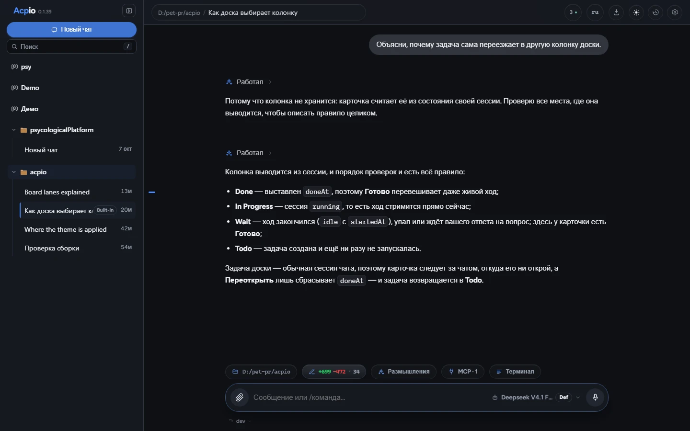
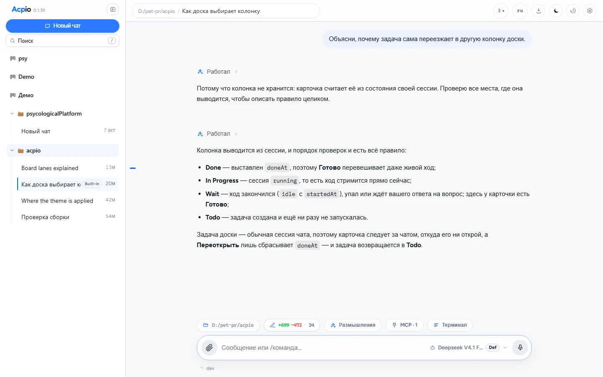
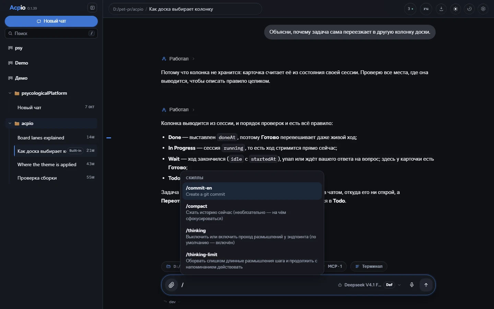
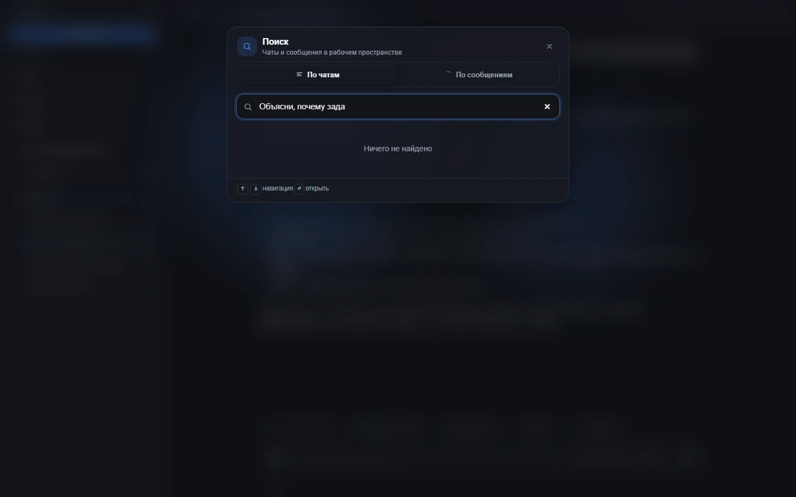
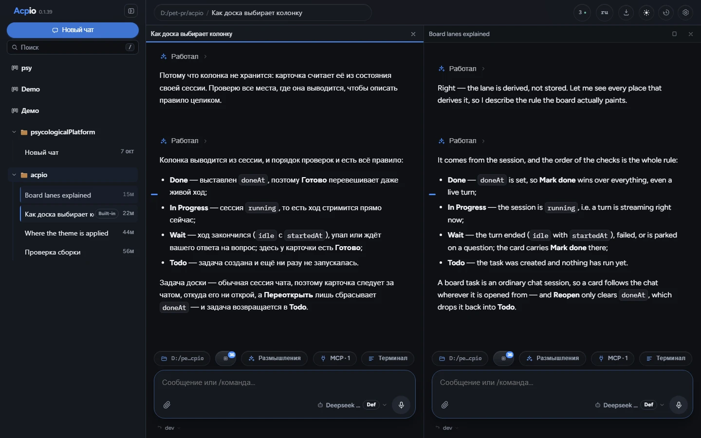
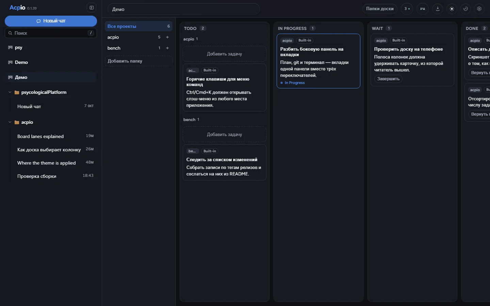
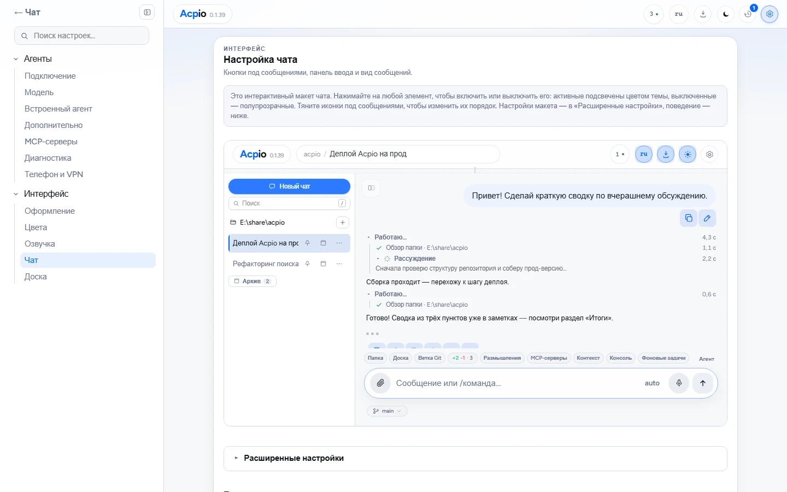
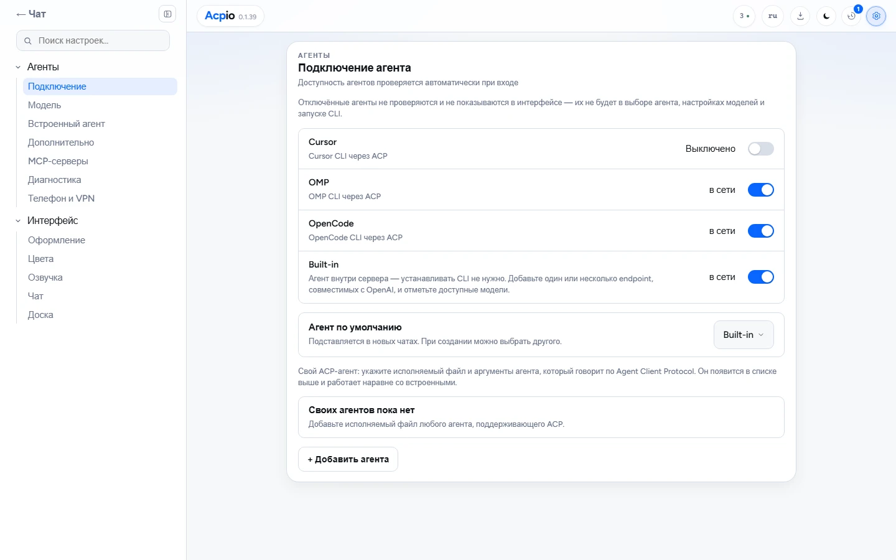
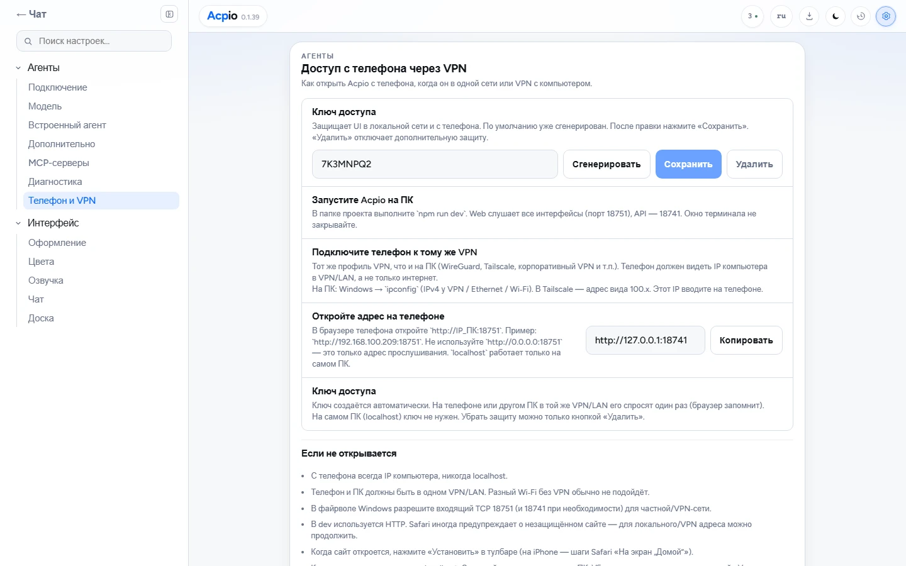
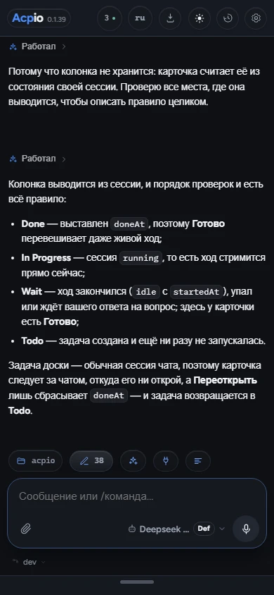

# Acpio

Самостоятельно размещаемый веб-харнесс для агентов по [ACP](https://agentclientprotocol.com/):
**Cursor CLI**, **OMP**, **OpenCode** — или **встроенный агент**, который работает прямо в
сервере, так что чат запускается вообще без установки CLI. Канбан-**доски** ведут задачи по
нескольким проектам сразу, и каждая задача — это отдельный чат.
Чат со стримом рассуждений, tool calls и субагентов, настройки, светлая/тёмная тема в стиле META.

**Актуальная версия:** 0.1.43

> **Disclaimer (AI):** This project was developed in substantial part with the help of AI coding assistants. Review, test, and verify changes before relying on it in production.

## Установка из npm

Самый короткий путь — без сборки, на любой ОС:

```bash
npx acpio          # запустить без установки
npm i -g acpio     # глобально → `acpio`
```

Открывает http://localhost:18741; `acpio --help` и `acpio --version` отвечают,
ничего не запуская.

> **npm 11.17+** не запускает install-скрипты пакета, пока его не разрешат, а
> именно они собирают нативные модули — добавьте к командам выше
> `--allow-scripts=acpio,better-sqlite3,node-pty`.

### Другие способы установки

**Установка в один клик (Windows)** — нужен Node 20+ (ставится автоматически
при первом запуске):

```powershell
irm https://raw.githubusercontent.com/Alek7eeey/acpio/dev/scripts/setup.ps1 | iex
```

**Из npm через PowerShell (Windows)** — тот же бутстрап Node 20+, затем глобальный
`npm i -g acpio@latest` с разрешёнными install-скриптами: нативные модули собираются
сразу, а команда `acpio` запускает приложение потом:

```powershell
irm https://raw.githubusercontent.com/Alek7eeey/acpio/dev/scripts/install.ps1 | iex
```

Сохраните скрипт в файл, чтобы передать `-Version 0.1.42` (закрепить релиз) или
`-NoLaunch` (только установить):

```powershell
irm https://raw.githubusercontent.com/Alek7eeey/acpio/dev/scripts/install.ps1 -OutFile install.ps1
powershell -ExecutionPolicy Bypass -File install.ps1 -NoLaunch
```

**Из исходников (прод, один порт):**

```bash
npm install
npm run build
npm run start     # → http://localhost:18741 (UI + API + WebSocket)
```

**Разработка (hot reload):**

```bash
npm install
npm run dev       # UI http://localhost:18751, API http://localhost:18741
```

**Портативный дистрибутив (Windows):** `npm run dist` → `dist-app/acpio-win-x64.zip`,
распакуйте куда угодно и запустите `start.cmd`. В zip зашит нативный better-sqlite3,
поэтому собирайте его на той ОС/архитектуре, под которую распространяете (сейчас Windows x64).

Заметки:

- Прод: [http://localhost:18741](http://localhost:18741) — UI + API + WebSocket;
  dev: UI [http://localhost:18751](http://localhost:18751), API
  [http://localhost:18741](http://localhost:18741).
- Схема БД создаётся при старте сервера (идемпотентный `ensureSchema`); `.env`
  опционален — у всех настроек есть рабочие значения по умолчанию.
- Файл БД: `data/acpio.db` (переопределяется `DATABASE_PATH`); npm-версия держит его в
  пользовательском каталоге (`%LOCALAPPDATA%\acpio\data`,
  `$XDG_DATA_HOME`/`~/.local/share/acpio/data`,
  `~/Library/Application Support/acpio/data`), поэтому обновление не трогает ваши чаты.
- После `git pull` сделайте **hard refresh** в браузере (`Ctrl+Shift+R`) — кеш старых
  CSS/JS модулей скрывает новые правки.

## Скриншоты

### Чат

Тёмная и светлая темы: стрим рассуждений, tool calls и карточки субагентов.

| Тёмная | Светлая |
|---|---|
|  |  |

### Слэш-команды, поиск, два чата

Введите `/` в поле ввода — откроется меню команд агента (из ACP `available_commands`). Поиск по сообщениям в чате. На десктопе — два чата рядом.

| Слэш-меню | Поиск | Два чата |
|---|---|---|
|  |  |  |

### Канбан-доска

Доска — отдельное рабочее пространство: четыре колонки — **Todo**, **In Progress**,
**Wait**, **Done**, — рельса папок, в которых она работает, и один чат на задачу.



### Настройки и телефон

Подключение агентов, модели, доступ с телефона по VPN/LAN.

| Настройки чата | Агенты | Телефон и VPN | Мобильный |
|---|---|---|---|
|  |  |  |  |

Переснять скриншоты после изменений UI: `npm run screens` (нужны `npm run dev` и
`npx playwright install chromium`, либо `SCREEN_BASE_URL=http://127.0.0.1:18741` для
прод-сборки). Английские кадры — файлы `*-en.webp`, русские — без суффикса. Скрипт
выбирает чаты, чей текст совпадает с языком кадра.

## Харнессы

| Харнесс | Команда | Аргументы | Что нужно |
|---|---|---|---|
| Cursor CLI | `agent` | `acp` | — |
| OMP | `omp` | `acp` | — |
| OpenCode | `opencode` | `acp` | — |
| Встроенный агент | — | — | один OpenAI-совместимый endpoint (URL + ключ) |
| Свой агент | любой ACP-CLI | — | **Настройки → Агенты → Подключение → Свои агенты** |

1. В **Настройки → Агенты → Подключение** нажмите **Проверить** — сервер запустит
   ACP-процесс и покажет его модели.
2. Command, args и API key переопределяются в **Настройки → Агенты → Дополнительно →
   «CLI и права»**; permission policy для локальной работы: `Всегда разрешать`.
3. Нажмите **Подключить**, затем создайте чат.

Ненужный харнесс отключается тумблером в **Настройки → Агенты → Подключение**: он больше
не проверяется и исчезает из выбора агента, настроек моделей и полей CLI. Если чат «завис» —
нажмите **Стоп** и отправьте снова.

- **Встроенный агент** — агент внутри сервера: ничего не нужно ставить через `npm i -g`,
  отдельного логина тоже нет. В **Настройки → Встроенный агент** живут один или
  несколько OpenAI-совместимых endpoint'ов и отмеченные для агента модели; **Пресеты
  агента** режут того же агента на собственные профили (быстрый, с местом на размышление),
  и они попадают в выбор агента как обычный харнесс. Инструменты: `read`, `glob`, `grep`,
  `write`, `edit`, `bash`, `ask`, `plan` и MCP-серверы из **Настройки → MCP**.
- **Свои ACP-агенты** — **Настройки → Агенты → Подключение → Свои агенты**: укажите
  исполняемый файл и аргументы, и агент ведёт себя как встроенный харнесс.

Документация: [docs/usage-ru.md](docs/usage-ru.md) — харнессы, доски и плагины ·
[docs/adapters-ru.md](docs/adapters-ru.md) — как написать плагин харнесса.
Ядро харнесс-агностично: харнесс — это плагин `packages/adapter-*`, зарегистрированный в
`apps/server/src/adapters/registry.ts`, а интерфейс строит список провайдеров, поля CLI и
модели из `GET /api/adapters`.

## Доски

Доска создаётся вкладкой **Доска** в окне нового чата или кнопкой **Новая доска** в дереве
чатов; переименовать её можно в пилюле над колонками, а проекты добавить через **Папки
доски**. **+** у группы запускает задачу в этой папке — агент и тумблер **Стартовать сразу**
в форме решают, кто её выполнит и когда, а к первой отправке можно приложить файлы. Колонка
карточки следует за сессией: не запущенная задача стоит в **Todo**, живой ход — в **In
Progress**, а завершённый ход, ждущий вас вопрос или ошибка — в **Wait**, откуда **Готово** и
**Переоткрыть** двигают её руками. Задачи доски не показываются в дереве чатов, а удаление
доски удаляет и их. Подробности: [docs/usage-ru.md](docs/usage-ru.md#канбан-доски).

## Телефон и VPN

Сервер слушает все интерфейсы (`0.0.0.0`), поэтому UI открывается с телефона в том же
VPN/LAN: запустите acpio, откройте на телефоне `http://IP_ПК:18741` (dev: `:18751`) и при
необходимости разрешите входящий TCP **18741** (и **18751**) в файрволе.
**Настройки → Телефон и VPN** показывают шпаргалку с копированием адреса; кнопка
**Установить** в тулбаре добавляет сайт на домашний экран. `http://0.0.0.0:18741` — это адрес
прослушивания, а не адрес для браузера.

## Тесты

```bash
npm test                 # unit, интеграция сервера, компоненты в jsdom (vitest)
npm run test:e2e         # собранное приложение в настоящем браузере (Playwright)
```

E2E-набор гоняет прод-сборку, а не dev-серверы: поднимает собранный сервер на своей базе
(`tmp/e2e`, стирается перед каждым запуском), регистрирует детерминированного ACP-агента
из `apps/server/test/fake-agent.mjs` и прогоняет одни и те же спеки на десктопном лэйауте
(1440×900) и двух телефонах (Pixel 7, iPhone SE). Каждый спек получает свой чат, а глобальные
настройки приложения возвращаются к исходным перед следующим.

### Какие тесты какой командой

Первый раз — собрать приложение и поставить браузер:

```bash
npm run build && npx playwright install chromium
```

Дальше — выбираешь команду, больше ничего настраивать не надо:

| Команда | Что гоняет | Тестов | Время |
|---|---|---|---|
| `npm run test:e2e` | всё: десктоп + Pixel 7 + iPhone SE | 20 | ~1,5 мин |
| `npm run test:e2e:desktop` | только десктопный лэйаут, 1440×900 | 10 | ~35 с |
| `npm run test:e2e:mobile` | только телефоны: Pixel 7 и iPhone SE | 10 | ~30 с |

`desktop.spec.ts` живёт только в проекте `desktop`, `mobile.spec.ts` — в двух телефонных
(`mobile` = Pixel 7, `mobile-small` = iPhone SE), поэтому его пять тестов в полном прогоне
считаются дважды. Один тест или группу можно запустить так: `npm run test:e2e:desktop -- -g "desktop shell"`.

Помощники набора живут в `e2e/support/`: `server.mjs` — тестируемое приложение (собранный
сервер на своей базе, :18761; `node e2e/support/server.mjs` поднимает его руками), `seed.mjs` —
фейковый агент и настройки, с которых начинается каждый тест, `app.ts` — общие фикстуры
спеков, `manifest-reporter.mjs` — индекс, который читает слайдшоу скриншотов.

### Как посмотреть прогон

Зелёная строка в логе не доказывает, что экран выглядит правильно. Посмотреть один и тот же
набор можно тремя способами: первый — вживую, остальные два — после прогона. Запускай их по
одному: два прогона сразу делят `tmp/e2e/artifacts` и одну базу и ломают друг друга.

| Что нужно | Команда | Где открывается |
|---|---|---|
| гонять тесты руками, смотреть каждый шаг | `npm run test:e2e:ui` | своё окно Playwright (порт случайный; `--ui-port 9333` фиксирует) |
| страница на тест, с трассами | `npm run test:e2e:report` | http://localhost:9323 (после прогона) |
| все скриншоты подряд | `npm run test:e2e:gallery` | http://127.0.0.1:9324/gallery/ (`--port` меняет) |

Оба сервера живут ровно столько, сколько живёт запустившая их команда (Ctrl+C — адрес
перестаёт отвечать); файлы в `tmp/e2e` живут дольше — до следующего прогона. Отчёт пишет сам
прогон, а слайдшоу читает `tmp/e2e/manifest.json`, который тоже пишет прогон, — поэтому оба
всегда показывают *последний* прогон, и обоим нужен прогон до них.

**Способ 1 — гонять тесты руками (UI-режим)**

```bash
npm run test:e2e:ui
```

Окно Playwright открывается само — никакого адреса открывать и запоминать не надо. В нём:

1. слева список тестов; чип `Projects:` в верхней панели решает, какие лэйауты в нём видны
   (`desktop`, `mobile`, `mobile-small`);
2. ▶ у теста или группы (`desktop shell`, `phone chat`…) запускает только её; ▶ в шапке
   списка — всё, что показывает текущий фильтр;
3. после прогона клик по любому действию в таймлайне: у каждого свой скриншот и снапшот DOM —
   промах по кнопке на телефонном лэйауте видно, а не приходится угадывать;
4. вкладки снизу (Console, Network, Source, Errors) — это тот момент страницы;
5. иконка глаза — watch-режим: правишь код, тест перезапускается сам.

После закрытия окна пересмотреть нечего — этот прогон живёт только пока окно открыто.

**Способ 2 — прогнать, а потом читать отчёт**

```bash
npm run test:e2e          # весь набор: desktop + Pixel 7 + iPhone SE, ~1.5 минуты
npm run test:e2e:report   # отдаёт tmp/e2e/report на http://localhost:9323
```

В консоли — строка на тест и итог:

```
  ok  1 [desktop] › desktop.spec.ts:20:3 › desktop shell › boots the chat view … (3.0s)
  …
  20 passed (1.1m)
```

В отчёте — строка на тест; `View Trace` под строкой прокручивает его шаги с теми же
скриншотами и консолью — после прогона и сразу по всем тестам. Локально каждый тест, включая
зелёные, оставляет скриншот и полную трассу; в CI пишутся только упавшие.
`npx playwright show-trace tmp/e2e/artifacts/<test>/trace.zip` открывает одну трассу отдельно.

**Или все скриншоты разом**

```bash
npm run test:e2e:gallery   # http://127.0.0.1:9324/gallery/
```

Отчёт показывает по тесту на страницу, а это — тот же прогон лентой скриншотов: кадр на тест,
в порядке прогона, с подписью «проект, группа, название». ← / → листать, Space — автоплей,
чипы сверху — оставить только один лэйаут. Читает `tmp/e2e/manifest.json`, его пишет сам
прогон (`e2e/support/manifest-reporter.mjs`), поэтому слайдшоу всегда показывает последний —
после нового прогона запусти команду снова. `-- --port 9400` меняет порт, `-- --no-serve`
только пишет страницу.

Порядок важен: прогон *пишет* `tmp/e2e/report`, а `test:e2e:report` только *отдаёт* его. Новый
прогон стирает папку под открытой вкладкой, и она начинает отдавать 404 — поэтому сначала
прогон, потом команда отчёта, и повторять её после каждого нового прогона.
`test:e2e:desktop` / `test:e2e:mobile` — тот же набор, суженный до одного лэйаута.

CI запускает их после `npm test` в той же job `ci`, поэтому сломанная оболочка или
разъехавшийся телефонный лэйаут краснят обязательную проверку; упавший прогон выкладывает
трейсы и скриншоты артефактом.

## Архитектура

Браузер ↔ REST/WS сервер ↔ запуск CLI харнесса через реестр адаптеров (`agent acp` /
`omp acp` / `opencode acp`, JSON-RPC NDJSON) или встроенный агент в процессе сервера ↔ SQLite.

События `session/update`, permissions, вопросы, планы и карточки субагентов отображаются в
ленте чата через нормализованные события адаптеров.

## Версионирование

Релиз выпускается по мере накопления изменений. Каждый релиз — это git-тег
`v<major>.<minor>.<patch>`, и тот же номер публикуется в npm. Список релизов — в `VERSIONS.md`,
новые сверху.

### `ACPIO_TAKEOVER=1` — принудительный захват занятой базы (только для человека)

Один acpio на один файл базы: старт на занятой базе отказывает и называет pid владельца.
С `ACPIO_TAKEOVER=1` отказ заменяется на «убить и захватить» — проверить, что владелец
действительно acpio, убить **всё дерево** его процессов и забрать лок.

**Этой возможностью может пользоваться только человек.** Агентам и CI использовать её
нельзя: она силой убивает того, кто держит лок, а два живых сервера на одной базе — ровно та
порча данных, от которой лок и существует. Без переменной поведение прежнее: отказ.

## Лицензия

MIT — см. [LICENSE](LICENSE).
